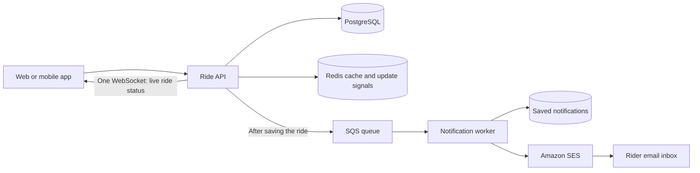
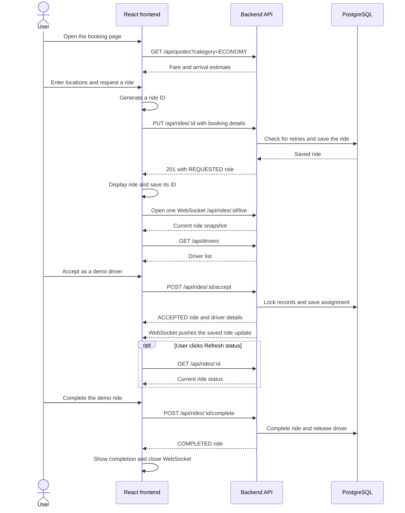

# Raasta backend

A ride-booking API for the website and a future mobile app.

- **Express:** handles API requests.
- **PostgreSQL:** saves riders, drivers, and rides safely.
- **Redis:** caches the driver list and shares live-update signals between backend instances.
- **WebSocket:** sends ride updates to one browser connection; **Refresh status** provides a manual check.
- **SQS:** holds notification jobs for background workers.
- **Amazon SES:** sends ride-update emails when configured.

The code is available. AWS deployment and testing with thousands of users are still pending.

## Backend folders (MVC)

```text
backend/
  src/
    controllers/   Handle requests and return JSON responses
    models/        Read and save PostgreSQL data
    services/      Apply booking rules
    routes/        Connect API URLs to controllers
    validators/    Check request fields
    middleware/    Handle shared request checks and errors
    db/            Database connection, migrations, and seed data
    cache/         Redis driver-list cache
    realtime/      WebSocket connections and shared live updates
    events/        Send ride messages to SQS
    workers/       Shared background-worker support
    config/        Environment settings
    shared/        Common error class
    app.js         Build the Express application
    server.js      Start the API
  services/notifications/   Separate notification worker
  tests/                    Backend tests
```

Requests follow **route → controller → service → model → database**. The controller returns JSON. React is the view, in the separate `frontend/` folder; the API does not need HTML view templates.

## How it works



**Example:** Ali accepts a ride. The API saves the assignment, sends a short message directly to SQS, and confirms the ride. A worker saves the notification and, when email is enabled, sends it through Amazon SES. No publisher service or extra pending-events table is needed.

## Frontend API flow

The frontend shows the booking screen. The backend checks requests and saves rides. Booking actions use HTTP requests and JSON responses. One WebSocket connection delivers live ride updates. The user can also click **Refresh status**; there is no timed status polling.

### Diagram: one booking from start to finish



The driver controls are demo buttons on the website. A future driver app could call the same endpoints. One WebSocket opens when a ride is requested, stays open after acceptance, and closes when the ride finishes or the page leaves that ride.

### Step 1: open the page and load the fare

[BookingPage.tsx](../frontend/src/pages/BookingPage.tsx) starts [useRideBooking.ts](../frontend/src/features/rides/useRideBooking.ts), which holds the booking data and makes API calls.

The selected category starts as Economy. The frontend sends:

```http
GET /api/quotes?category=ECONOMY
```

The API returns `{"farePaisa":48000,"etaMinutes":4}`. The screen shows **PKR 480** and **4 minutes**. Selecting Comfort sends another quote request. Booking stays disabled until a quote is available.

### Step 2: enter pickup and destination

[BookingCard.tsx](../frontend/src/features/rides/components/BookingCard.tsx) displays the form and buttons. Typing changes React state; it does not send a location-search request. The current location suggestions are a fixed list.

### Step 3: request a ride

When the user clicks **Request a ride**, the frontend:

1. Disables the booking button while the request runs.
2. Trims the pickup and destination text.
3. Generates a UUID for this booking, or reuses it when retrying unchanged details.
4. Sends the booking to the API:

```http
PUT /api/rides/aaaaaaaa-aaaa-4aaa-8aaa-aaaaaaaaaaaa
Content-Type: application/json

{
  "riderId": "11111111-1111-4111-8111-111111111111",
  "pickup": "Liberty Market, Lahore",
  "destination": "DHA Phase 5, Lahore",
  "category": "ECONOMY"
}
```

The rider ID is currently a fixed demo identity. The ride ID in the URL identifies this booking; no separate retry header is needed.

### Step 4: the backend checks and saves

The request passes through these files:

| File | Job |
| --- | --- |
| [routes/index.js](src/routes/index.js) | Selects the matching endpoint and validation rules. |
| [ride.validator.js](src/validators/ride.validator.js) | Checks IDs, locations, and category. |
| [ride.controller.js](src/controllers/ride.controller.js) | Reads valid input and calls the service. |
| [ride.service.js](src/services/ride.service.js) | Checks an existing ride ID and the rider's active booking, then creates the ride safely. |
| [ride.model.js](src/models/ride.model.js) | Runs the database queries. |

A new booking returns **201** with the saved ride. Repeating the same ID and details returns **200** with the existing ride. Conflicting details return **409**.

The frontend puts the response into React state and saves the returned ride ID in browser `localStorage` under `raasta-ride`. The form changes to the ride-status screen.

### Step 5: load drivers

While the ride is `REQUESTED`, the frontend calls `GET /api/drivers`. The API returns all demo drivers, using Redis when a valid cached list exists.

The screen shows acceptance buttons only for drivers marked available and matching the ride category. The backend checks again during acceptance because that list can become stale.

### Step 6: accept a ride

Clicking **Accept as Ali Hassan** sends:

```http
POST /api/rides/aaaaaaaa-aaaa-4aaa-8aaa-aaaaaaaaaaaa/accept
Content-Type: application/json

{ "driverId": "22222222-2222-4222-8222-222222222222" }
```

The backend saves the assignment and driver availability together. The returned ride has status `ACCEPTED` and driver details. The frontend immediately updates the screen from that response.

### Step 7: keep the status up to date

[ride-updates.ts](../frontend/src/lib/ride-updates.ts) opens one browser WebSocket at `/api/rides/:id/live`. The backend first sends the current ride, then pushes updates after saved ride changes. The screen applies them immediately.

```json
{ "type": "ride.updated", "ride": { "id": "<ride ID>", "status": "ACCEPTED" } }
```

This example shows only the key fields; the real message includes the complete ride object. Late replies cannot move a finished ride back to an earlier state.

**Manual refresh:** clicking **Refresh status** calls `GET /api/rides/:id` once. While still requested, it also refreshes the driver list. This works even when live updates are disconnected.

**Reconnect:** a lost socket reconnects with a short increasing delay and receives a fresh database snapshot. There is no five-second HTTP timer. Ping/pong messages only check the socket connection; they do not query ride status.

For several backend instances, Redis Pub/Sub shares ride-change signals between them. Without Redis, live updates work only within one API process. If Redis is down, cross-instance events may be missed until reconnect or manual refresh. The browser never connects to Redis, SQS, or PostgreSQL. SQS notification records are still not displayed by this screen. A separate worker can email the rider through SES when configured; this does not add another browser connection.

### Step 8: complete, cancel, or book again

| User action | API call | Screen behavior |
| --- | --- | --- |
| Complete a demo ride | `POST /api/rides/:id/complete` with `{}` | Shows completion and closes the WebSocket. |
| Cancel a ride | `POST /api/rides/:id/cancel` with `{}` | Shows cancellation and closes the WebSocket. |
| Book another ride | No API call yet | Clears the saved ride ID and pending booking ID, then shows the form. Submitting creates a new ride ID. |

### Step 9: refresh the page

On page load, the frontend checks `localStorage`. If a ride ID is saved, it calls `GET /api/rides/:id` and restores that ride. This can happen alongside the initial quote request. An active restored ride then opens its WebSocket and receives a current snapshot.

Only a successfully returned ride ID is saved today. An unanswered booking's pending ID stays in memory while the page is open; recovery after closing the page would need additional storage.

### Where requests go

[http.ts](../frontend/src/lib/http.ts) is the shared API helper. It adds the base URL and JSON header, calls browser `fetch`, reads JSON, and turns unsuccessful responses into errors.

- **Default local setup:** the browser calls `/api/...` on the Vite server. [vite.config.ts](../frontend/vite.config.ts) forwards HTTP requests and WebSocket upgrades to `http://127.0.0.1:4000`.
- **Separate API host:** `VITE_API_BASE_URL` supplies the full API base URL, including `/api`. The backend's `CORS_ORIGINS` must allow the website origin. The WebSocket URL is derived from this API base, using `ws://` for HTTP or `wss://` for HTTPS. Production proxies must support WebSocket upgrades.

### If a request fails

| Failure | What the user sees / what happens next |
| --- | --- |
| Quote cannot load | Booking stays disabled; **Try again** requests the quote again. |
| Booking fails | Form stays filled, an error appears, and the button is enabled again. Retrying unchanged input uses the same ride ID. |
| Accept/cancel/complete fails | The last known ride stays visible; an error appears and the user can retry. |
| WebSocket disconnects | The last status stays visible, the connection label changes, and the socket retries. **Refresh status** remains available. |
| Manual refresh fails | The last status stays visible and an error asks the user to try again. |
| Driver list or saved ride cannot load | A message asks the user to refresh. |

The helper normally sets a 15-second timeout. Quote calls supply their own cancellation signal, so they do not currently get that default timeout.

The current demo has no user authentication. Production must check ride ownership before allowing a socket subscription, just as it must protect ride HTTP endpoints.

For every backend file, see [FILE_GUIDE.md](FILE_GUIDE.md).

## 1. Setup

Requires Node.js 22.12+ or 24, npm, and Docker Desktop, or existing database services. Inside `backend/`, run `npm ci`, then copy `.env.example` to `.env`. Set the database password and use the same password in `DATABASE_URL`.

```sh
docker compose up -d db redis
npm run db:migrate
npm run db:seed
npm run dev
```


| Setting | Purpose |
| --- | --- |
| `DATABASE_URL` | Ride database connection; local database port is `5433` |
| `POSTGRES_PASSWORD` | Local Docker database password |
| `HOST`, `PORT` | API address; defaults to `127.0.0.1:4000` |
| `REDIS_URL` | Normally `redis://127.0.0.1:6379`; enables caching and live updates across instances. Empty uses local live updates only |
| `REALTIME_CHANNEL` | Redis channel shared by one deployment; use different names for development, testing, and production |
| `CORS_ORIGINS` | Allowed website origins, separated by commas, without paths or trailing slashes |
| `SQS_QUEUE_URL`, `AWS_REGION` | Queue used by the API and worker; empty queue URL disables API notifications. Region defaults to `us-east-1` |
| `NOTIFICATIONS_DATABASE_URL` | Notification database connection; may use a separate database |
| `SQS_ENDPOINT_URL` | Local SQS emulator address only; leave unset on AWS |
| `SES_FROM_EMAIL` | Verified SES sender address; leave empty to save notifications without sending email |
| `DEMO_RIDER_EMAIL` | Demo recipient saved in `riders.email` by `npm run db:seed` |

## 2. API

Base URL: **`http://127.0.0.1:4000/api`**. Send JSON using `Content-Type: application/json`. Record IDs are UUIDs.

| Method | Path | Purpose / input |
| --- | --- | --- |
| GET | `/health` | Check PostgreSQL; returns `{"status":"ok"}` |
| GET | `/quotes?category=ECONOMY` | Return fare and arrival estimate |
| GET | `/drivers` | List all drivers, including unavailable ones |
| PUT | `/rides/:id` | Create a ride with a client-generated ride ID; same ID/details safely retry |
| GET | `/rides/:id` | Get ride details, including manual refresh |
| WS | `/rides/:id/live` | One WebSocket for the current snapshot and live updates |
| POST | `/rides/:id/accept` | Accept using `{"driverId":"<UUID>"}` |
| POST | `/rides/:id/cancel` | Cancel; no required body fields |
| POST | `/rides/:id/complete` | Complete; no required body fields |

### Create a ride

```http
PUT /api/rides/aaaaaaaa-aaaa-4aaa-8aaa-aaaaaaaaaaaa
Content-Type: application/json

{
  "riderId": "11111111-1111-4111-8111-111111111111",
  "pickup": "Liberty Market, Lahore",
  "destination": "DHA Phase 5, Lahore",
  "category": "ECONOMY"
}
```

The client creates one ride UUID before sending the request. No custom retry header is required. This replaces the old `POST /rides` creation endpoint.

Pickup and destination must be different and each have 2-200 characters after trimming. The rider must exist. Categories are `ECONOMY` or `COMFORT`.

Economy costs PKR 480 with a four-minute estimate. Comfort costs PKR 780 with a six-minute estimate. These are fixed demo values chosen by the backend.

Creation returns `201`; an identical retry returns `200`. Other successful endpoints return `200`. Ride responses contain the booking fields listed in the `rides` table below, except the unused legacy retry columns. They also include `driver_name`, `vehicle`, and `plate`; driver fields are `null` before assignment. Money is in paisa: `48000` = PKR 480. Dates are date-time strings. Quotes use `farePaisa` and `etaMinutes`.

**Ride states:** `REQUESTED ? ACCEPTED ? COMPLETED`. Requested or accepted rides may be cancelled. Finished rides cannot reopen. Acceptance checks driver availability and category. Completion/cancellation releases the assigned driver.

**Safe retries:** use the same ride ID in the URL and the same booking details after a timeout. The backend returns that ride, even if it has since completed or been cancelled. Different details or a different rider with that ID return `409 RIDE_ID_CONFLICT`. A genuinely new booking needs a new ID. This endpoint does not edit an existing booking.

The website reuses the pending ride ID while the page stays open. To recover an unanswered request after restarting an app, also save its pending ID and details on the device. Disabling a button or checking for one active ride alone cannot recognize every retry. This follows the [HTTP PUT approach](https://www.rfc-editor.org/rfc/rfc9110.html#section-9.3.4).

Errors use `{"error":{"code":"...","message":"..."}}`. Validation errors also list problem fields in `details`.

| Status | Meaning |
| --- | --- |
| 400 | Invalid fields or JSON |
| 404 | Rider, driver, ride, or endpoint not found |
| 409 | Duplicate request with changed details, active ride, unavailable driver, or invalid action |
| 413 | Request body too large |
| 500 | Unexpected server/database failure |

## 3. Database tables

A **primary key** uniquely identifies a row. A **foreign key** links to another table. `timestamptz` means a date/time with time-zone support. Optional columns can be empty (`NULL`).

### `riders`: who books

| Column | Type | Meaning |
| --- | --- | --- |
| `id` | UUID | Primary key |
| `name` | text | Required rider name |
| `email` | text | Optional rider email address, read by the API for notification jobs |

### `drivers`: who drives

| Column | Type | Meaning |
| --- | --- | --- |
| `id` | UUID | Primary key |
| `name` | text | Required driver name |
| `category` | text | Required; `ECONOMY` or `COMFORT` |
| `available` | boolean | Required; starts as `true` |
| `vehicle` | text | Required vehicle description |
| `plate` | text | Required and unique |

Availability means the driver can take an assignment; it does not show online/GPS status.

### `rides`: bookings

| Column | Type | Meaning |
| --- | --- | --- |
| `id` | UUID | Primary key, generated by the client and used in the booking URL |
| `rider_id` | UUID | Required link to `riders.id` |
| `pickup` | text | Required pickup label; trimmed length 2-200 |
| `destination` | text | Required destination label; trimmed length 2-200 |
| `category` | text | Required; `ECONOMY` or `COMFORT` |
| `status` | text | Required ride state; starts as `REQUESTED` |
| `driver_id` | UUID | Optional link to `drivers.id`; assigned when accepted |
| `fare_paisa` | integer | Required fare, greater than zero |
| `eta_minutes` | integer | Required estimate, greater than zero |
| `idempotency_key` | UUID | Optional legacy column; no longer used for new bookings |
| `request_hash` | text | Optional legacy column; old values are preserved, new bookings leave it empty |
| `created_at` | timestamptz | Required; starts at the current time |
| `updated_at` | timestamptz | Required; starts at the current time; code updates it on changes |

### `notifications.inbox`: saved notifications

This table belongs to the notification service and can live in a separate database. No foreign keys to ride tables are needed.

| Column | Type | Meaning |
| --- | --- | --- |
| `event_id` | UUID | Primary key; prevents duplicate notifications |
| `ride_id` | UUID | Required ride ID |
| `rider_id` | UUID | Required rider ID |
| `event_type` | text | Required event name, such as `ride.accepted` |
| `status` | text | Required; one of the four ride states |
| `occurred_at` | timestamptz | Required time when the event happened |
| `received_at` | timestamptz | Required; defaults to the time the message is saved |
| `message` | text | Required notification text |
| `email_to` | text | Optional recipient address copied from the event |
| `email_state` | text | Required; `PENDING`, `SENDING`, `SENT`, or `SKIPPED`; old records default to `SKIPPED` |
| `email_claim` | UUID | Optional temporary sending claim, preventing simultaneous workers sending the same event |
| `email_claim_until` | timestamptz | Optional claim expiry; a crashed worker can be retried after two minutes |
| `email_message_id` | text | Optional message ID returned by SES |
| `email_sent_at` | timestamptz | Optional time SES accepted the email; not proof it reached the inbox |
| `email_error` | text | Optional safe reason, such as `missing_recipient` or `email_send_failed` |

### `migrations`: ride database update history

| Column | Type | Meaning |
| --- | --- | --- |
| `name` | text | Primary key; applied version such as `001_release` |
| `applied_at` | timestamptz | Required; defaults to the time the update is recorded |

### `notification_migrations`: notification database update history

| Column | Type | Meaning |
| --- | --- | --- |
| `name` | text | Primary key; such as `001_notifications` or `002_email_delivery` |
| `applied_at` | timestamptz | Required; defaults to the time the update is recorded |

### Important database rules

- One rider can have only one requested/accepted ride. One driver can have only one accepted ride.
- The ride primary key prevents duplicate rows for the same ride ID. The backend compares the original booking fields to recognize a retry.
- Accepted/completed rides must have a driver; requested rides must not.
- Database locks stop two drivers from changing the same ride at once.
- Ride assignment and driver availability are saved together or undone together. SQS sending happens afterward.

Unique indexes enforce the active-ride limits and unique ride IDs. Other indexes support available-driver searches, pending-event lookup, and notification history. The application also checks matching categories and allowed actions. Driver details come from the current driver record, not a historical copy.

## 4. Migrations and demo data

A migration is a SQL file that creates or updates tables.

| File | Creates | Command |
| --- | --- | --- |
| [001_release.sql](src/db/migrations/001_release.sql) | Complete ride schema, including rider email, constraints, and indexes | `npm run db:migrate` |
| [001_notifications.sql](services/notifications/migrations/001_notifications.sql) | Saved notifications and their index | `npm run notifications:migrate` |
| [002_email_delivery.sql](services/notifications/migrations/002_email_delivery.sql) | Email recipient and sending state on the existing notification table | Same notification migration command |

Run `npm run db:migrate` on a fresh database before starting the API. The ride database uses one initial SQL file with the complete current schema, without incremental `ALTER TABLE` migrations. Existing databases created with the previous migration files must be recreated separately to use this baseline; this command does not reset them.

The runner creates the history tables, applies missing versions, and skips versions already applied. A failed run undoes its changes. The API does not run migrations on startup.

The ride baseline is registered in `src/db/migration-runner.js`; notification migrations remain separate in `services/notifications/migrate.js`. There is no automatic undo command. The ride schema does not create an outbox table.

`npm run db:seed` adds one demo rider and three drivers: Ali and Usman in Economy, Hamza in Comfort. It does not reset rides or availability. Existing names/vehicles stay unchanged. When `DEMO_RIDER_EMAIL` is provided, seeding sets or updates only the demo rider's email; an empty setting preserves any existing email. The booking example uses the seeded rider ID.

## 5. Redis and SQS: simple explanation

**Redis is a temporary driver list.** `GET /api/drivers` uses it for five seconds. An empty/broken cache falls back to PostgreSQL. Successful ride actions clear the list. It may briefly be stale, so acceptance always checks PostgreSQL again. Ride details and booking writes are not cached.

**SQS is a waiting line for notification jobs.** If many jobs arrive together, workers process them without making users wait for notifications. If a worker is temporarily down, messages wait in the queue.

**Do SQS queues need tables? No.** The API sends directly to SQS after PostgreSQL saves the ride. AWS stores queued messages. `notifications.inbox` only keeps the finished notification and prevents duplicates.

| Process | Command | Job |
| --- | --- | --- |
| API | `npm start` | Save rides, then send notification messages to SQS |
| Notification worker | `npm run worker:notifications` | Save notifications and send configured emails through SES |

Apply the database migrations before using the updated API. Set `NOTIFICATIONS_DATABASE_URL` and apply notification migrations before starting that worker. The API works without AWS when `SQS_QUEUE_URL` is empty. When enabled, its AWS role needs permission to send messages; the worker needs permission to receive/delete them. A local emulator can be used instead.

**Simple tradeoff:** saving a ride and sending to SQS are two separate steps. If the API crashes between them, or sending fails, the ride still succeeds but its notification may be lost. The API logs send failures; there is no saved retry job. Queue sending has a two-second request deadline, so it can add a short wait to the API response. The client can always read the real ride status from PostgreSQL.

The AWS client makes limited retries during a send. Repeating the same booking/action can resend the current status with the same event ID, preventing duplicate notification rows. Once SQS accepts a message, failed worker processing retries after 120 seconds; five unsuccessful receives move it to the failed-message queue (DLQ).

Normal queue messages are kept for four days; failed messages for fourteen days. Investigate and replay queued failures before they expire. Events that never reached SQS cannot be recovered automatically. Queue messages can arrive out of order; they do not overwrite the ride's current state.


### Email notifications: setup

**Example:** Ali accepts a ride. The API saves it and adds a message to SQS with the rider's saved email address. A worker sends **"A driver accepted your ride"** through SES. WebSocket still updates the open screen separately.

Emails cover requested, accepted, cancelled, and completed rides. They go to the rider, not the driver. The API reads `riders.email`; the booking request cannot supply an arbitrary recipient.

To enable email later:

1. Verify your sender email/domain in Amazon SES in `AWS_REGION`. In the SES sandbox, recipients must also be verified. See [SES setup rules](https://docs.aws.amazon.com/ses/latest/dg/request-production-access.html).
2. Set `SES_FROM_EMAIL` and `DEMO_RIDER_EMAIL` in `backend/.env`, along with the existing SQS and database settings. Use your real addresses; none are set automatically.
3. Run `npm run db:migrate`, `npm run notifications:migrate`, and `npm run db:seed` from `backend/`.
4. Give the worker AWS permission to call `ses:SendEmail` for your verified identity. Start/restart the API and `npm run worker:notifications`, then make a new booking.

With `SES_FROM_EMAIL` empty, the worker only saves notification records and marks email as skipped. Missing rider addresses are also skipped with a reason. Previously skipped records are not automatically emailed when settings change; configure email before creating test rides.

The worker records SES acceptance before deleting the SQS message. Normal retries skip an already sent email, and a temporary database claim stops two workers sending it at once. Failed sends stay pending and use SQS retries/DLQ handling. No extra table or outbox is added.

**Limit:** a crash or lost response after SES accepts an email but before its result is saved can cause a duplicate on retry. `SENT` means SES accepted it, not that the recipient read or received it. Bounce/complaint tracking, automatic email replay, and live AWS delivery tests are not included. No real emails were sent during implementation.

### Live status

The frontend opens `/api/rides/:id/live` after booking. The server loads the current ride and pushes updates after committed ride changes. It reads PostgreSQL again on every socket reconnect to recover current state. **Refresh status** makes a normal API request whenever the user wants. The socket closes when the ride is cancelled/completed or the user leaves it.

Redis Pub/Sub shares signals between API instances; each process uses shared Redis connections, not a Redis connection per user. Without Redis, live broadcasts only cover clients on the same API process. Redis Pub/Sub does not replay missed events; reconnect snapshots and manual refresh recover the current ride. Use a deployment-specific `REALTIME_CHANNEL`: Redis database numbers do not isolate Pub/Sub channels.

The server sends connection heartbeats every 30 seconds and disconnects dead or slow clients. Those heartbeats do not poll the database. In production, allow the website origin in `CORS_ORIGINS` and support WebSocket upgrades in the proxy. Local development defaults allow the frontend on port 5173 when no origins are configured. Origin checks are not authentication: this demo still needs user/ride access checks before production.

## 6. AWS and scaling

**Future deployment:** run the API on AWS ECS Fargate behind an Application Load Balancer. The load balancer will share HTTP requests and route WebSocket connections across API instances. Scale the API and notification workers separately as traffic grows. This API deployment is planned, not implemented.

[Dockerfile](Dockerfile) builds the service image. [workers.cfn.json](infra/workers.cfn.json) contains AWS setup for the queue, failed-message queue, worker permissions, separate worker containers, logs, alarms, and worker scaling.

The template starts two notification workers and provides a send-permission policy to attach to the existing API task role. Notifications can scale to a default maximum of twenty workers as queue delays grow. Each notification worker uses up to five database connections; API instances use ten. Count total connections before adding more workers.

The template needs an existing network, ECS cluster, container image, and a Secrets Manager reference holding the notification database URL. It does not create the API load balancer, databases, Redis, or login system. AWS roles provide worker permissions; do not put real AWS keys in code. To enable email in the worker template, set both `SesFromEmail` and `SesIdentityArn`. The template restricts SES permission to that identity and sender; it does not verify the SES identity or request sandbox removal. Nothing has been deployed.

For more users, run several API instances behind a load balancer and scale workers separately. Add city fields and city-specific queries/cache keys for multiple cities. Measure database load before promising capacity. Status updates use open WebSockets, not repeated HTTP requests. Configure proxies/load balancers for WebSocket upgrades and budget memory, connections, and database reads during reconnects. Thousands of connections have not been load-tested.

Watch failed/slow requests, database connections, waiting jobs, and failed messages. Keep backups and use database updates compatible with the previous app version so a faulty release can be rolled back. The worker template handles some startup rollback and alarms; a full production release setup is still needed.

A local SQS emulator is included under the optional `messaging` Compose profile. Its example settings and dummy `test` keys are in `.env.example`. No AWS account is required for the emulator.

## 7. Interview questions and answers

### 1. Why this stack and architecture?

React builds the screen, TypeScript catches frontend mistakes, and Express keeps the API simple. PostgreSQL saves bookings safely. Redis reduces repeated reads. SQS moves notifications into the background. Separate services let us increase background capacity without changing the API.

### 2. How do you prevent two drivers accepting the same ride?

The database lets one request change the ride at a time. If Ali accepts first, Usman's request sees that it is already taken. The assignment and driver's availability are saved together.

### 3. How do you handle retries and duplicates?

The app chooses the ride ID before sending a booking. Retrying `PUT /rides/:id` with the same ID and details returns that ride. No separate request key or header is needed. Background events also have unique IDs to prevent duplicate notification records.

### 4. What happens when an API request fails?

The UI shows an error, keeps the form, and allows a retry. Booking stays disabled if the fare cannot load. Ride changes arrive over one WebSocket. If it disconnects, the last status stays visible and the connection retries. A **Refresh status** button fetches the latest ride manually; there is no status polling.

### 5. How would you support more cities and thousands of users?

We handle more users by sharing the work:

1. **Run several backend instances.** A load balancer sends requests to different instances. AWS ECS can add instances as traffic grows. API scaling still needs deployment configuration; the existing worker template handles notification workers.
2. **Keep database queries efficient.** Use indexes and connection pools. Limit total database connections so adding backend instances does not overwhelm PostgreSQL.
3. **Use Redis for repeated reads.** Cached driver lists reduce database queries. Redis also shares live updates between backend instances.
4. **Use WebSockets for ride updates.** Users receive changes without requesting status every five seconds. Each backend manages some of the open connections.
5. **Send emails in the background.** SQS holds jobs while notification workers process them. Increase workers separately, within SES sending limits.
6. **Keep database locks short.** Booking and assignment checks stay inside short transactions. Email sending happens outside them.
7. **Measure before increasing capacity.** Load tests show where requests slow down. Monitor response time, database connections, errors, and queue delays.

For multiple cities, add a city to drivers, rides, and pricing, and use city-specific queries and cache keys.

**This architecture can grow, but we cannot promise a specific number of concurrent users until we load-test it.**

### 6. When would you add Redis, a broker, or separate services?

Redis and SQS workers are already in the code for repeated driver reads and background notifications. Split more features only when they need their own capacity or ownership. Avoid adding services without a clear reason.

### 7. How would you deploy, monitor, and roll back?

Build and test, release to a few instances first, and watch errors and response times. If the release fails, restore the previous version. Keep database changes compatible with it.

### 8. What are the three main improvements before production?

1. Rider/driver login and permission checks.
2. Real locations, nearby-driver matching, realistic prices, and phone notifications.
3. Load tests, monitoring, tested backups, and a tested rollback process.

## 8. Checks and current limits

`npm run build` checks JavaScript syntax. `npm test` runs tests. Set `TEST_DATABASE_URL` and `TEST_REDIS_URL` to disposable test services for integration tests.

Latest backend check: **98 tests passed;

The website can set `VITE_API_BASE_URL` and its origin in backend `CORS_ORIGINS`. Mobile apps use the same API. On a trusted local network, a phone must use the computer's network IP, not the phone's localhost.
